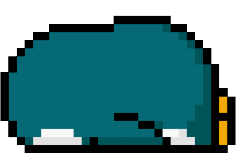
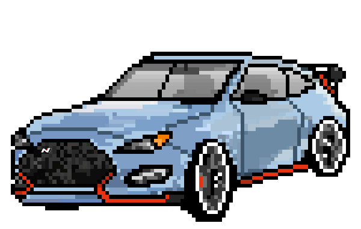
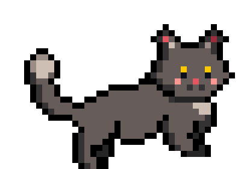
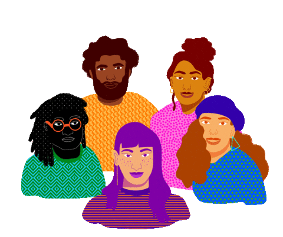

<!-- Header banner -->


<h2> Hi there, I'm Udit </h2>

<!-- Typing animation -->
<p>
  <a href="https://github.com/udit79">
    
  </a>
</p>

<p><em>
  Building <b>Agentic AI & RAG systems</b>
    
  </br>
  Exploring <b>Knowledge Graphs & Multi-Agent orchestration</b>
    
  </br>
  Learning <b>LangGraph & System Design</b>
    
</em></p>


### A little more about me...

```javascript
const udit = {
  pronouns: "he" | "him",
  code: ["Python", "TypeScript", "JavaScript", "C++"],
  ai: ["LangChain", "LangGraph", "Hugging Face", "Ollama", "Cognee", "MCP"],
  backend: ["FastAPI", "Node.js", "PostgreSQL", "Supabase", "Redis", "Neo4j"],
  learning: ["LangGraph", "Multi-Agent Systems", "Knowledge Graphs", "System Design"],
  lookingFor: "Advanced RAG architectures, agent orchestration, production-grade AI",
  funFact: "I understand complex systems by building their components from scratch"
}
```

 <em><b>I love connecting with different people,</b> so if you want to say <b>hi</b>, I'd be happy to meet you!</em>

<br clear="right">

## 🤝 Let's Collaborate

| 👯 Collaborate on | 🙋 Looking for help with | 💬 Ask me about |
| :--- | :--- | :--- |
| Agentic AI | Advanced RAG architectures | Python |
| RAG systems | Agent orchestration | AI / ML |
| Knowledge Graphs | Production-grade AI systems | RAG & Agentic AI |
| Open Source AI | | Backend Development |

## 💻 Tech Stack

**🐍 Python & ML**

       

**🤖 Agentic AI & LLM**

     

**🌐 Languages & Web**

     

**🗄️ Databases & Infra**

       

**🛠️ Tools**

      

## 📊 GitHub Stats

<p align="center">
  
  
</p>

<p align="center">
  
</p>

<p align="center">
  <a href="https://www.linkedin.com/in/udit-jain-640323380">
    
  </a>
  &nbsp;&nbsp;&nbsp;
  <a href="mailto:uditjain4724@gmail.com">
    
  </a>
</p>

<p align="center">
  
</p>

<!-- ============ FOOTER ============ -->

